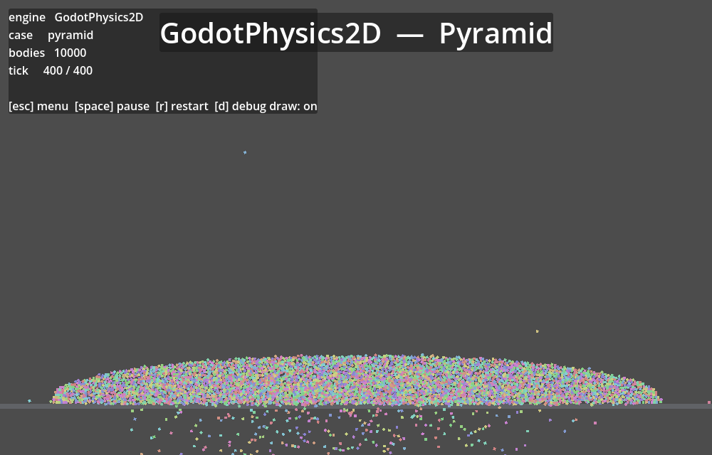
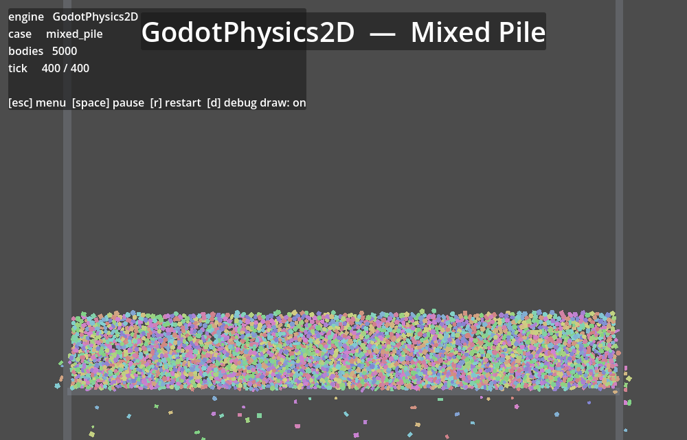
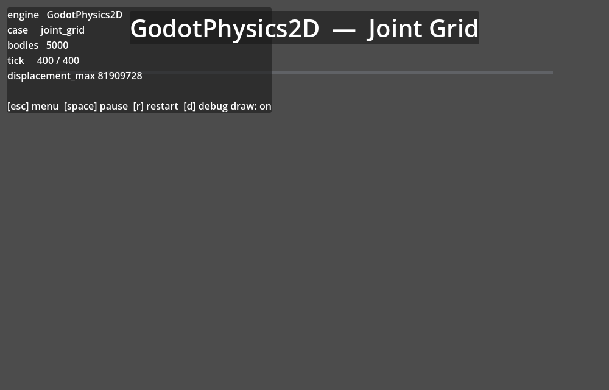
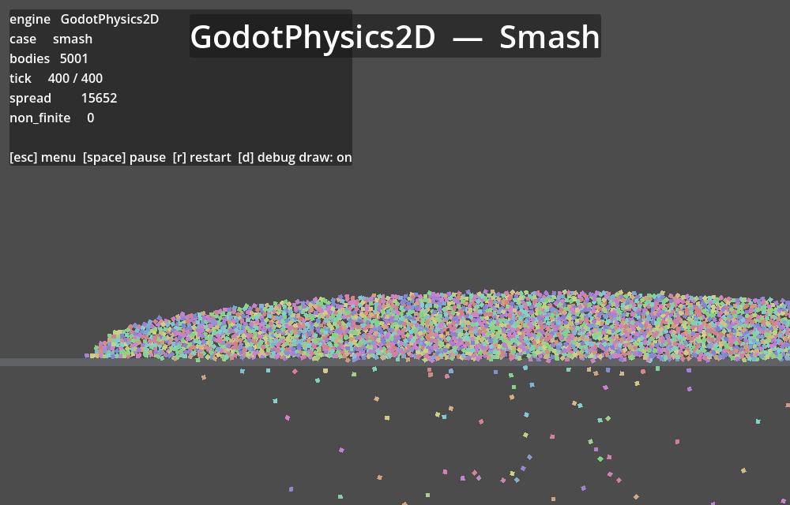
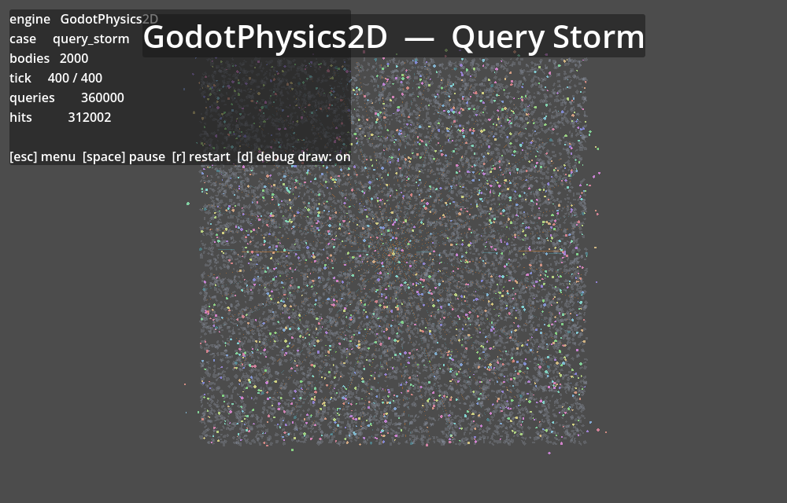

# Godot physics engine benchmark

## ⚠ Validity warnings

- 2d/joint_grid: GodotPhysics2D has `displacement_max` at 935,529x any other engine's, so the simulation exploded — its step time is not ranked.

Godot 4.7.1-stable (official) · 300 timed steps · 60 Hz · single run · lower is better.

## 2D (lower is better)

### `pyramid` (2d)

| Rapier2D | Box2D | GodotPhysics2D |
|---|---|---|
|  |  |  |

| engine | step p50 | step p99 | vs Rapier2D |
|---|---:|---:|---:|
| **Box2D** | **5.12 ms** | 5.80 ms | 0.34x |
| Rapier2D | 14.94 ms | 20.29 ms | — |
| GodotPhysics2D | 94.97 ms | 152.88 ms | 6.36x |

### `mixed_pile` (2d)

| Rapier2D | Box2D | GodotPhysics2D |
|---|---|---|
|  |  |  |

| engine | step p50 | step p99 | vs Rapier2D |
|---|---:|---:|---:|
| **Box2D** | **2.56 ms** | 2.91 ms | 0.42x |
| Rapier2D | 6.05 ms | 7.29 ms | — |
| GodotPhysics2D | 40.30 ms | 45.55 ms | 6.66x |

### `joint_grid` (2d)

| Rapier2D | Box2D | GodotPhysics2D |
|---|---|---|
|  |  |  |

| engine | step p50 | step p99 | vs Rapier2D |
|---|---:|---:|---:|
| GodotPhysics2D | diverged | — | — |
| **Box2D** | **2.08 ms** | 2.28 ms | 0.42x |
| Rapier2D | 4.98 ms | 5.36 ms | — |

| engine | `displacement_max` |
|---|---|
| Box2D | 16.51 |
| GodotPhysics2D | 15444226 |
| Rapier2D | 5.319 |

### `smash` (2d)

| Rapier2D | Box2D | GodotPhysics2D |
|---|---|---|
|  |  |  |

| engine | step p50 | step p99 | vs Rapier2D |
|---|---:|---:|---:|
| **Box2D** | **2.87 ms** | 3.33 ms | 0.39x |
| Rapier2D | 7.28 ms | 10.86 ms | — |
| GodotPhysics2D | 34.57 ms | 43.50 ms | 4.75x |

| engine | `spread` |
|---|---|
| Box2D | 3369 |
| GodotPhysics2D | 1.484e+04 |
| Rapier2D | 3449 |

### `query_storm` (2d)

| Rapier2D | Box2D | GodotPhysics2D |
|---|---|---|
|  |  |  |

| engine | step p50 | step p99 | vs Rapier2D |
|---|---:|---:|---:|
| **Box2D** | **2.51 ms** | 2.64 ms | 0.58x |
| Rapier2D | 4.31 ms | 4.47 ms | — |
| GodotPhysics2D | 45.40 ms | 46.02 ms | 10.54x |

| engine | `hits` | `queries` |
|---|---|---|
| Box2D | 280563 | 323100 |
| GodotPhysics2D | 280132 | 323100 |
| Rapier2D | 258360 | 323100 |

### `drop` (2d)

| engine | step p50 | step p99 | vs Rapier2D |
|---|---:|---:|---:|
| **Box2D** | **4.18 ms** | 4.77 ms | 0.34x |
| Rapier2D | 12.27 ms | 14.47 ms | — |
| GodotPhysics2D | 66.05 ms | 103.94 ms | 5.38x |
