# Godot physics engine benchmark

Godot 4.7.1-stable (official) · 300 timed steps · 60 Hz · single run · lower is better.

## 2D (lower is better)

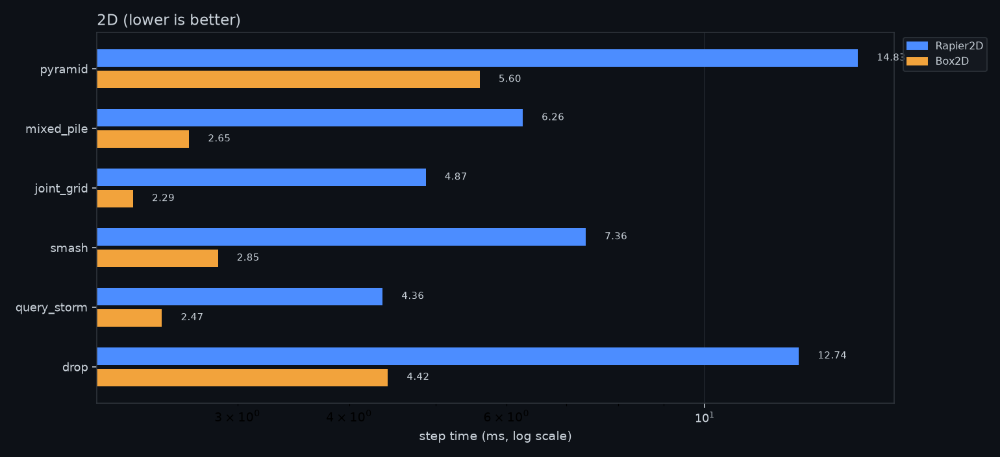

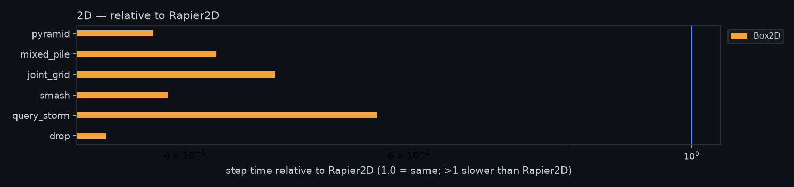

### `pyramid` (2d)

| Rapier2D | Box2D |
|---|---|
| 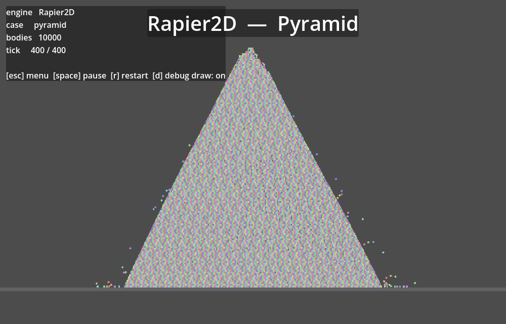 | 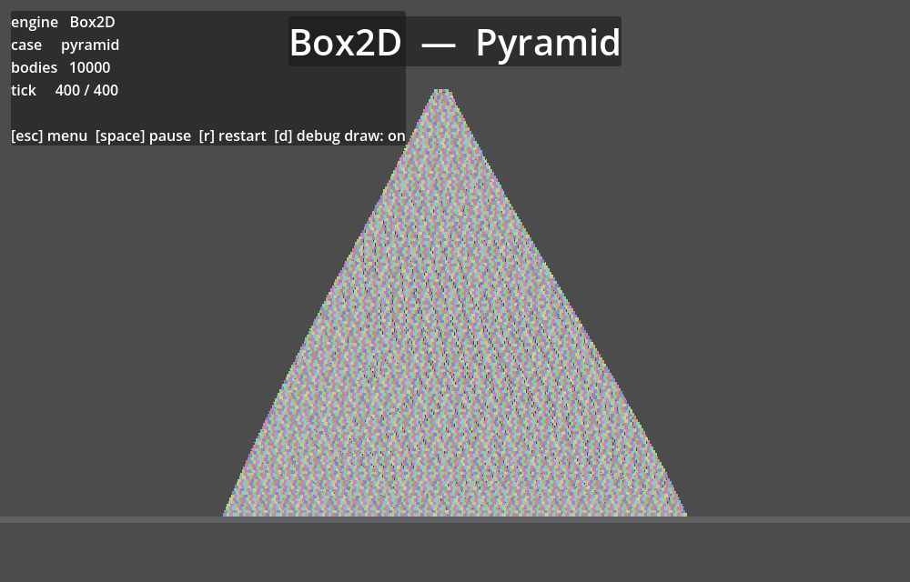 |

| engine | step p50 | step p99 | vs Rapier2D |
|---|---:|---:|---:|
| **Box2D** | **5.60 ms** | 6.16 ms | 0.38x |
| Rapier2D | 14.83 ms | 19.81 ms | — |

### `mixed_pile` (2d)

| Rapier2D | Box2D |
|---|---|
| 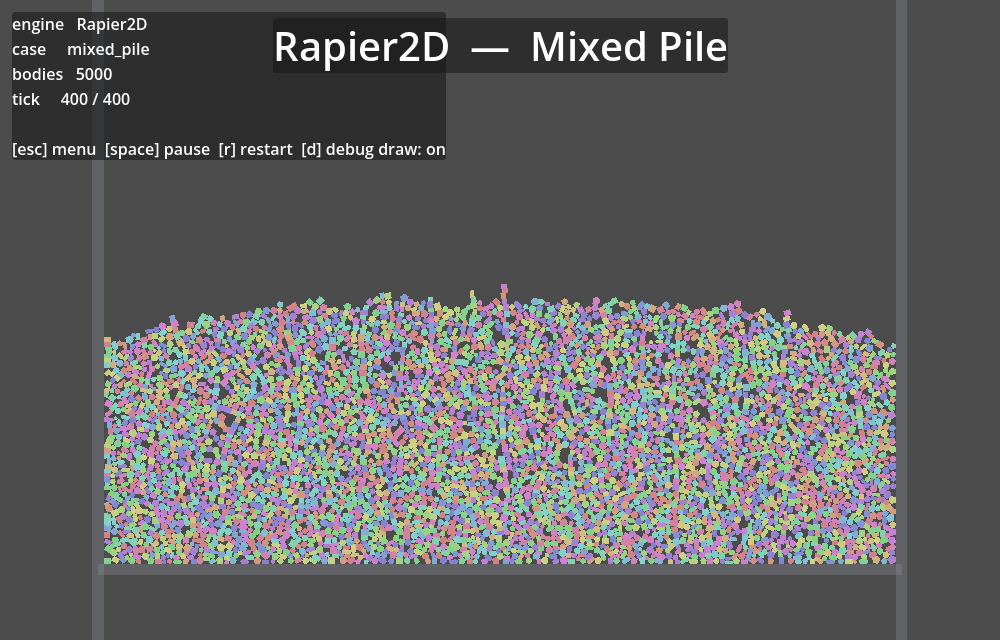 | 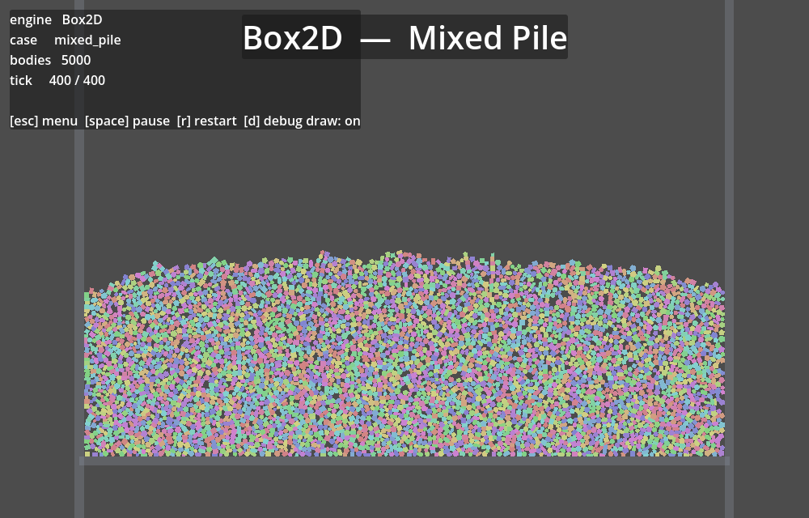 |

| engine | step p50 | step p99 | vs Rapier2D |
|---|---:|---:|---:|
| **Box2D** | **2.65 ms** | 3.67 ms | 0.42x |
| Rapier2D | 6.26 ms | 8.11 ms | — |

### `joint_grid` (2d)

| Rapier2D | Box2D |
|---|---|
| 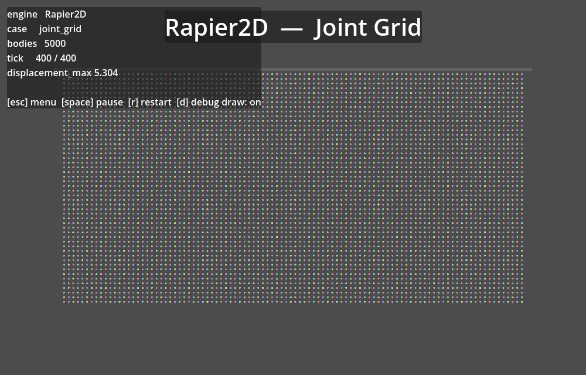 | 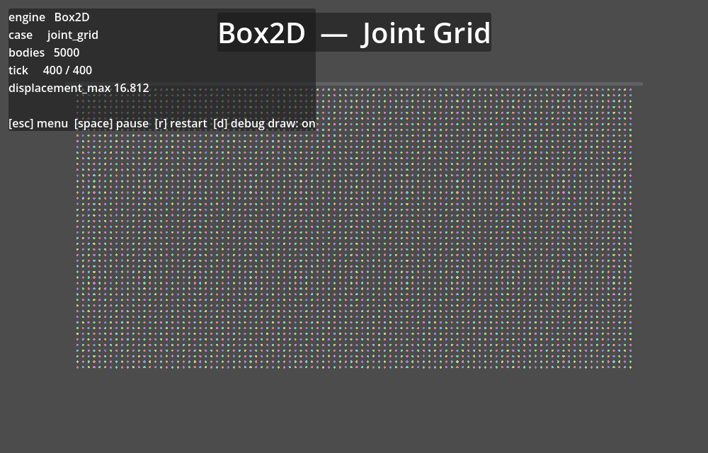 |

| engine | step p50 | step p99 | vs Rapier2D |
|---|---:|---:|---:|
| **Box2D** | **2.29 ms** | 2.76 ms | 0.47x |
| Rapier2D | 4.87 ms | 5.80 ms | — |

| engine | `displacement_max` |
|---|---|
| Box2D | 16.51 |
| Rapier2D | 5.319 |

### `smash` (2d)

| Rapier2D | Box2D |
|---|---|
| 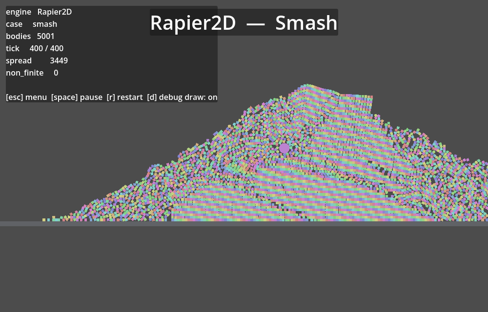 | 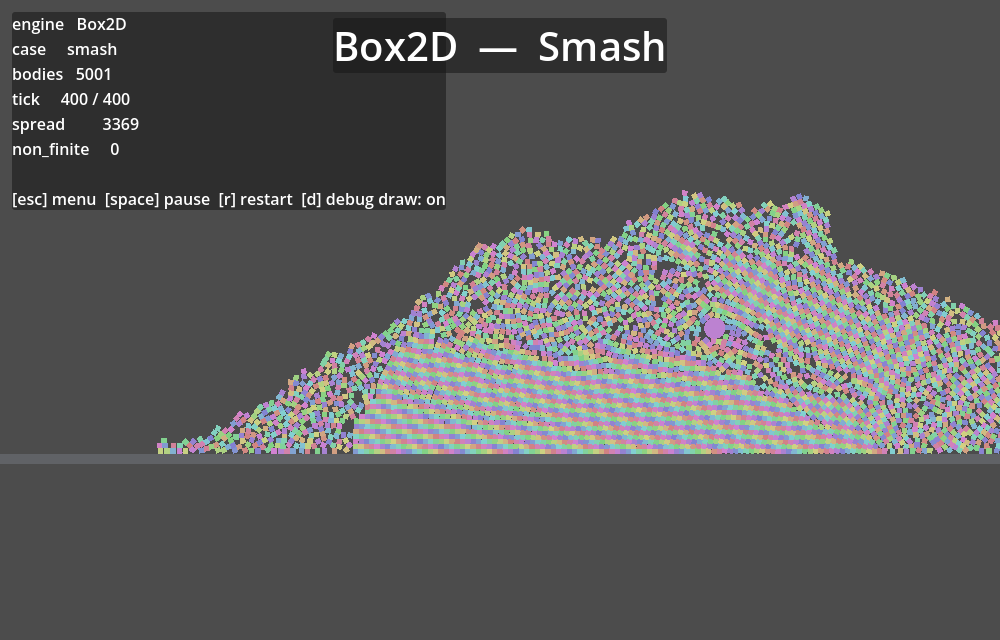 |

| engine | step p50 | step p99 | vs Rapier2D |
|---|---:|---:|---:|
| **Box2D** | **2.85 ms** | 3.28 ms | 0.39x |
| Rapier2D | 7.36 ms | 11.36 ms | — |

| engine | `spread` |
|---|---|
| Box2D | 3369 |
| Rapier2D | 3449 |

### `query_storm` (2d)

| Rapier2D | Box2D |
|---|---|
| 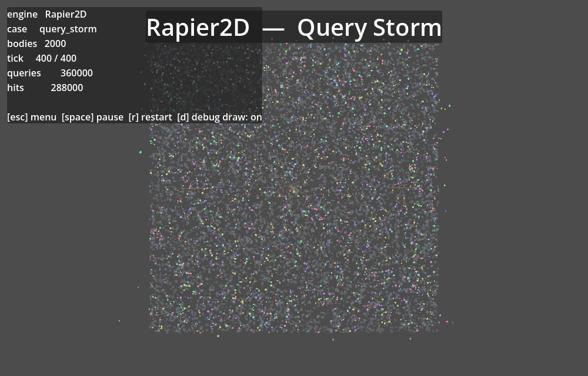 | 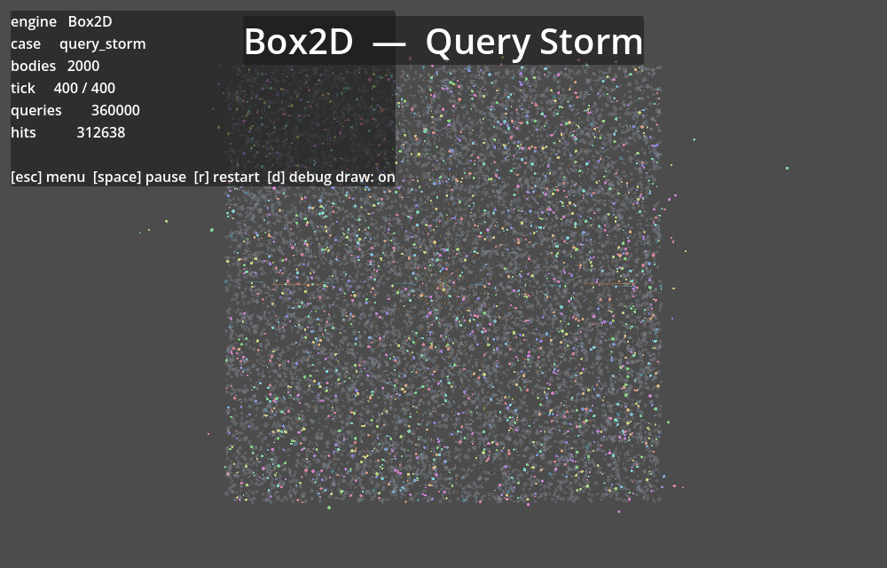 |

| engine | step p50 | step p99 | vs Rapier2D |
|---|---:|---:|---:|
| **Box2D** | **2.47 ms** | 2.73 ms | 0.57x |
| Rapier2D | 4.36 ms | 6.51 ms | — |

| engine | `hits` | `queries` |
|---|---|---|
| Box2D | 280563 | 323100 |
| Rapier2D | 258360 | 323100 |

### `drop` (2d)

| engine | step p50 | step p99 | vs Rapier2D |
|---|---:|---:|---:|
| **Box2D** | **4.42 ms** | 5.14 ms | 0.35x |
| Rapier2D | 12.74 ms | 18.27 ms | — |
