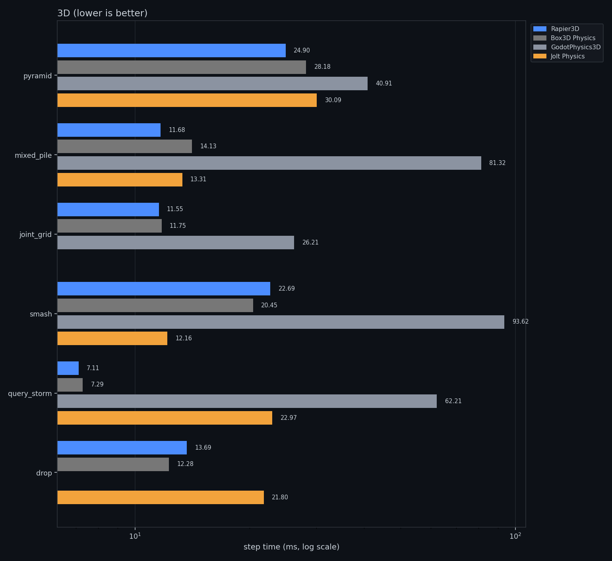
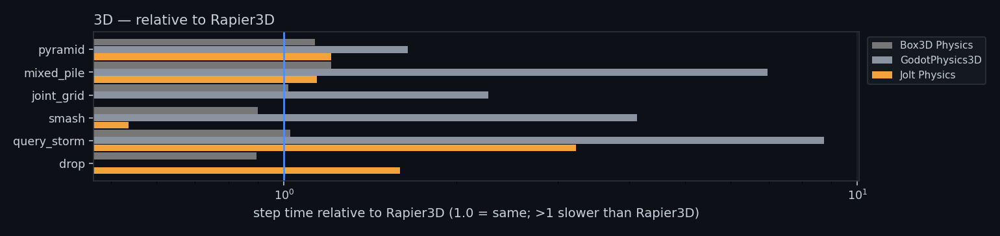
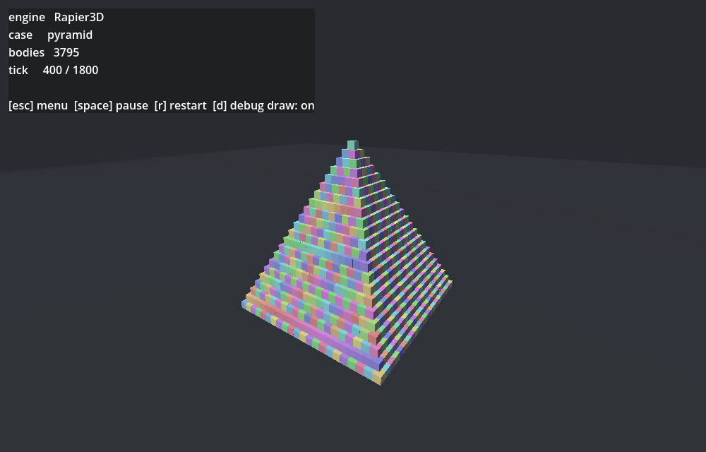
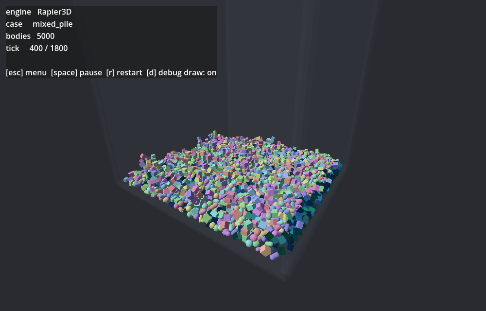
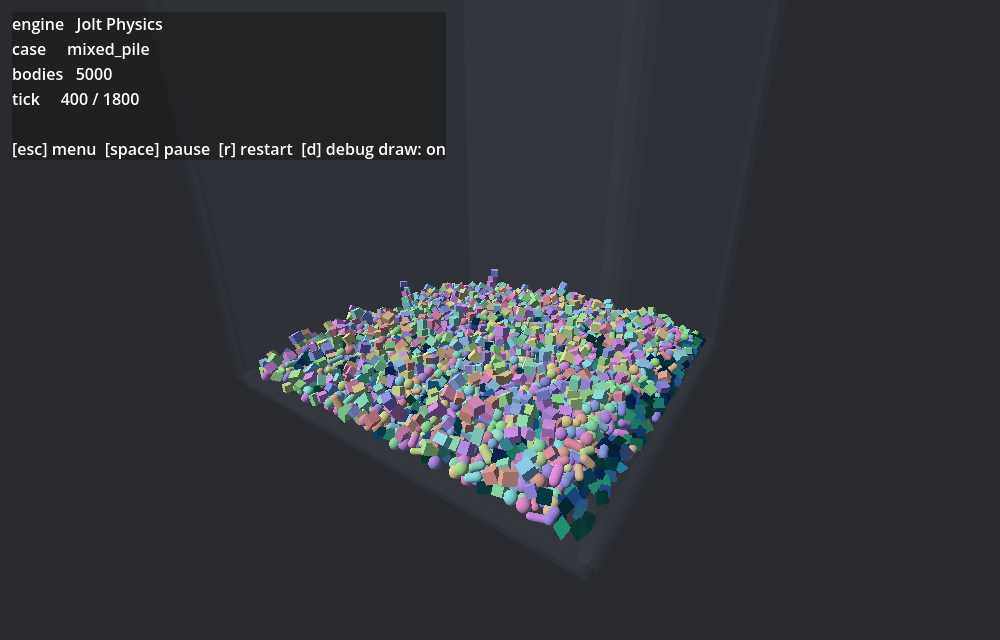
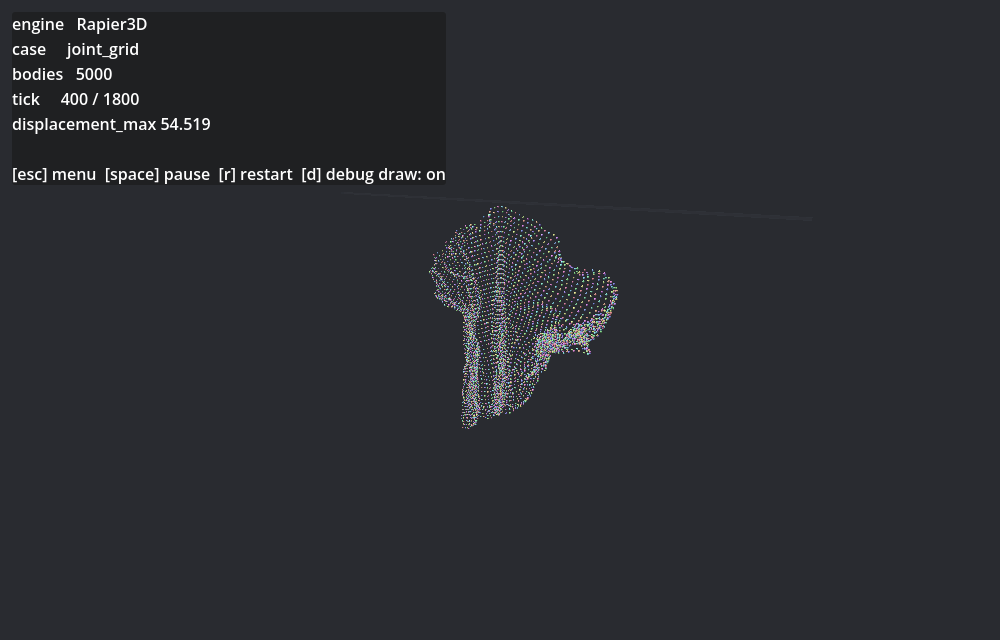
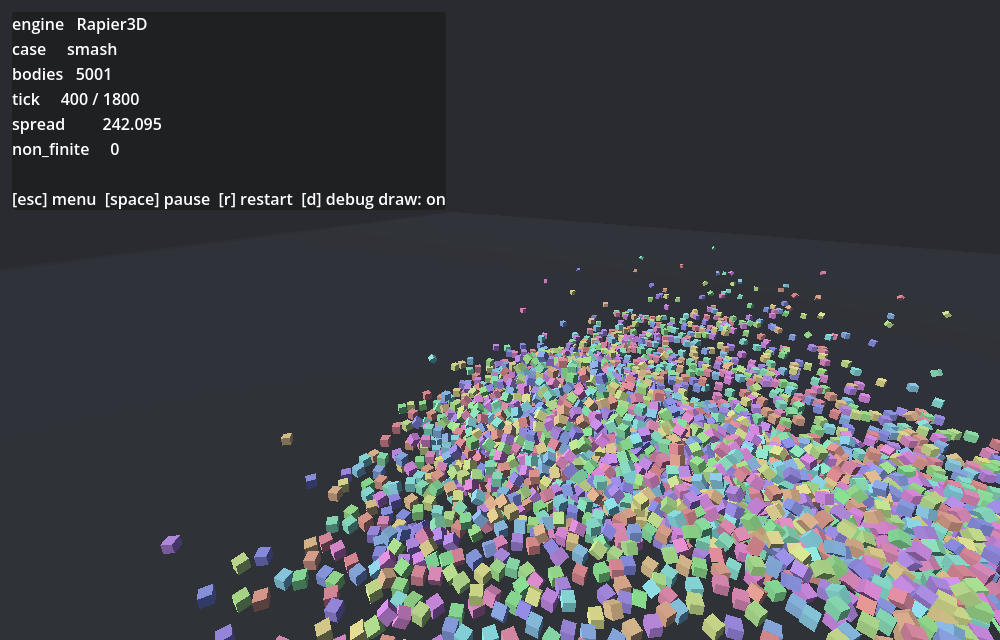
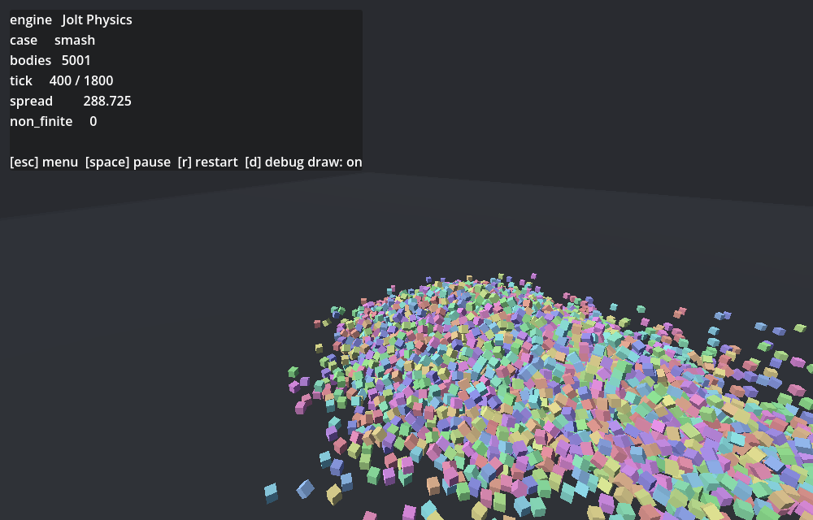
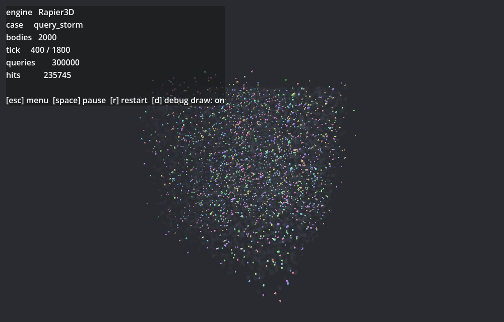
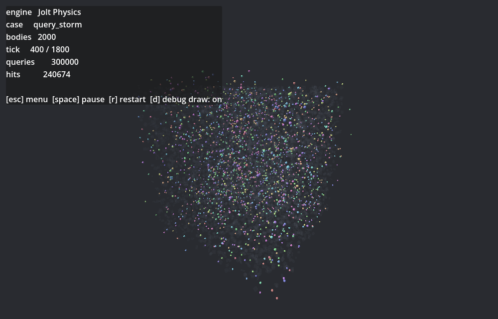

# Godot physics engine benchmark

Godot 4.7-stable (official) · 300 timed steps · 60 Hz · single run · lower is better.

## 3D (lower is better)

### `pyramid` (3d)

| Rapier3D | Jolt Physics |
|---|---|
|  |  |

| engine | step p50 | step p99 | vs Rapier3D |
|---|---:|---:|---:|
| **Rapier3D** | **24.90 ms** | 34.05 ms | — |
| Box3D Physics | 28.18 ms | 46.73 ms | 1.13x |
| Jolt Physics | 30.09 ms | 38.79 ms | 1.21x |
| GodotPhysics3D | 40.91 ms | 129.65 ms | 1.64x |

### `mixed_pile` (3d)

| Rapier3D | Jolt Physics |
|---|---|
|  |  |

| engine | step p50 | step p99 | vs Rapier3D |
|---|---:|---:|---:|
| **Rapier3D** | **11.68 ms** | 19.98 ms | — |
| Jolt Physics | 13.31 ms | 70.03 ms | 1.14x |
| Box3D Physics | 14.13 ms | 18.11 ms | 1.21x |
| GodotPhysics3D | 81.32 ms | 135.91 ms | 6.96x |

### `joint_grid` (3d)

| Rapier3D |
|---|
|  |

| engine | step p50 | step p99 | vs Rapier3D |
|---|---:|---:|---:|
| Jolt Physics | failed | — | — |
| **Rapier3D** | **11.55 ms** | 43.15 ms | — |
| Box3D Physics | 11.75 ms | 20.35 ms | 1.02x |
| GodotPhysics3D | 26.21 ms | 47.85 ms | 2.27x |

| engine | `displacement_max` |
|---|---|
| Box3D Physics | — |
| GodotPhysics3D | 40.65 |
| Rapier3D | 25.58 |

### `smash` (3d)

| Rapier3D | Jolt Physics |
|---|---|
|  |  |

| engine | step p50 | step p99 | vs Rapier3D |
|---|---:|---:|---:|
| **Jolt Physics** | **12.16 ms** | 33.86 ms | 0.54x |
| Box3D Physics | 20.45 ms | 36.94 ms | 0.90x |
| Rapier3D | 22.69 ms | 54.84 ms | — |
| GodotPhysics3D | 93.62 ms | 128.10 ms | 4.13x |

| engine | `spread` |
|---|---|
| Box3D Physics | 422.2 |
| GodotPhysics3D | 140.6 |
| Jolt Physics | 280.3 |
| Rapier3D | 189.3 |

### `query_storm` (3d)

| Rapier3D | Jolt Physics |
|---|---|
|  |  |

| engine | step p50 | step p99 | vs Rapier3D |
|---|---:|---:|---:|
| **Rapier3D** | **7.11 ms** | 10.48 ms | — |
| Box3D Physics | 7.29 ms | 13.15 ms | 1.02x |
| Jolt Physics | 22.97 ms | 38.79 ms | 3.23x |
| GodotPhysics3D | 62.21 ms | 89.82 ms | 8.75x |

| engine | `hits` | `queries` |
|---|---|---|
| Box3D Physics | 215900 | 269250 |
| GodotPhysics3D | 215893 | 269250 |
| Jolt Physics | 215893 | 269250 |
| Rapier3D | 215792 | 269250 |

### `drop` (3d)

| engine | step p50 | step p99 | vs Rapier3D |
|---|---:|---:|---:|
| GodotPhysics3D | failed | — | — |
| **Box3D Physics** | **12.28 ms** | 15.15 ms | 0.90x |
| Rapier3D | 13.69 ms | 20.35 ms | — |
| Jolt Physics | 21.80 ms | 53.43 ms | 1.59x |
